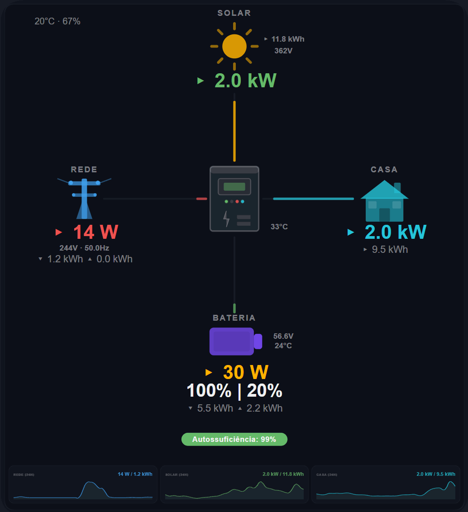

A power flow visualization card for solar hybrid inverters in Home Assistant. Single file, no dependencies.



## Supported Inverters

| Brand | Integration | Status |
|-------|-------------|--------|
| **Deye** | Solarman / deye_inverter | Tested |
| **Sunsynk** | Sunsynk / Modbus | Preset |
| **Huawei** | FusionSolar | Preset |
| **Fronius** | Gen24 / Modbus | Preset |
| **Growatt** | Growatt / Modbus | Preset |
| **Victron** | Venus OS / GX | Tested |
| **SolarEdge** | Modbus / SunSpec | Preset |
| **Solis** | SolisCloud / Modbus  | Preset / Tested |
| **Any other** | Custom | Custom preset |

Select your brand in the visual editor. Entities and polarity are configured automatically.

## Features

**Diagram**
* 9 inverter presets with auto-configured entities and polarity, plus one-click entity auto-detection
* Up to 3 MPPT inputs (`solar`, `solar2`, `solar3`), with per-string power and voltage
* Animated chevron (or comet) flows whose speed and pulse density follow the power; `flow_speed: synced` keeps all flows in step
* Inverter → home flow coloured by the mix feeding the home (solar green / battery amber / grid red)
* Inverter icon with 3 status LEDs (solar, battery discharge, grid import) and a grid status bar
* Battery gauge with backup reserve zone, split-colour percentage, and charge/discharge time estimate (until full, the reserve, or sunset)
* Self-sufficiency badge and an optional "energy source" frame around the card, split by what feeds the home
* Sun ring with sunrise/sunset, replaced by an animated weather icon when `weather_entity` is set (moon at night)
* Trend arrows and smooth count-up on value changes
* Click any node to open its more-info dialog (each MPPT string separately)

**Optional nodes**
* EV charger with SOC and daily energy
* Up to 6 extra consumers: 3 above the home and 3 below it, each with its own icon and label
* Separate AC/DC battery charger, with efficiency
* `show_solar: false` for installations without PV (the card gets shorter)

**Charts**
* Today's energy chart: solar, home and grid, with the solar forecast from the Energy dashboard; click the legend to hide a line
* Today's battery chart (state of charge, energy charged / discharged)

**Look**
* `xpower` style or `ha` style (follows your Home Assistant theme), light and dark themes with automatic detection
* Detail levels (`essential`, `normal`, `technical`) to show only what you need
* Custom colours (`colors:`) and custom icons (`mdi:…` or your own images)
* Compact mode (diagram only), adjustable font size, MPPT text size, flow size and length
* Respects `prefers-reduced-motion`; animations pause when the card is off screen

**Other**
* 9 languages (Portuguese, English, German, French, Spanish, Italian, Dutch, Polish, Swedish), following Home Assistant's language by default
* Visual editor for the common options, fully translated, with live entity validation
* Three-phase grid voltage, grid frequency, inverter and battery temperatures
* Electricity price and daily import cost / export earnings
* Split battery charge/discharge sensors (e.g. Solis / Modbus)
* Units in W / kW (or automatic), °C / °F
* Unavailable sensors shown as `--`; automated tests run on every change

## Installation

### HACS (Recommended)

[](https://my.home-assistant.io/redirect/hacs_repository/?owner=BTNBx&repository=xPower-Flow-Card&category=dashboard)

1. Open **HACS** in Home Assistant
2. Search for **"xPower Flow Card"** and install
3. Refresh your browser (Ctrl+Shift+R)

### Manual

1. Download `xpower-flow-card.js` from the [latest release](https://github.com/BTNBx/xPower-Flow-Card/releases)
2. Copy to `/config/www/xpower-flow-card.js`
3. Add resource in **Settings > Dashboards > Resources**:
   - URL: `/local/xpower-flow-card.js`
   - Type: JavaScript Module
4. Refresh your browser

## Configuration

### Visual Editor

Add the card through the UI and use the built-in visual editor. Select your inverter brand from the **Preset** dropdown to fill in the entity and polarity fields, or use auto-detection. The editor only writes the options you change to the YAML.

### YAML (Deye example)

```yaml
type: custom:xpower-flow-card
preset: deye
language: pt
inverter_name: DEYE 6K
shutdown_soc: 20
battery_capacity: 5120
weather_temp: sensor.outdoor_temperature
weather_humidity: sensor.outdoor_humidity
```

### YAML (multiple MPPT example)

```yaml
type: custom:xpower-flow-card
preset: deye
solar: sensor.deye_pv1_power
solar2: sensor.deye_pv2_power
pv_voltage: sensor.deye_pv1_voltage
pv_voltage2: sensor.deye_pv2_voltage
```

### YAML (Huawei example)

```yaml
type: custom:xpower-flow-card
preset: huawei
language: de
inverter_name: Huawei SUN2000
shutdown_soc: 10
battery_capacity: 10000
```

### YAML (Custom / any inverter)

```yaml
type: custom:xpower-flow-card
preset: custom
language: en
inverter_name: My Inverter
bat_polarity: negative
grid_polarity: positive
shutdown_soc: 15
battery_capacity: 10240
solar: sensor.my_pv_power
solar2: sensor.my_pv2_power
battery: sensor.my_battery_power
soc: sensor.my_battery_soc
grid: sensor.my_grid_power
load: sensor.my_load_power
grid_voltage: sensor.my_grid_voltage
battery_voltage: sensor.my_battery_voltage
pv_voltage: sensor.my_pv_voltage
pv_voltage2: sensor.my_pv2_voltage
temperature: sensor.my_inverter_temp
frequency: sensor.my_grid_frequency
grid_status: binary_sensor.my_grid_connected
daily_solar: sensor.my_daily_production
daily_import: sensor.my_daily_import
daily_export: sensor.my_daily_export
daily_load: sensor.my_daily_consumption
daily_charge: sensor.my_daily_charge
daily_discharge: sensor.my_daily_discharge
battery_temperature: sensor.my_battery_temp
weather_temp: sensor.my_outdoor_temp
weather_humidity: sensor.my_outdoor_humidity
```

### Options

Entity options take an entity id; leave them empty to hide what they drive. With a brand preset the main entities are filled in for you.

#### Inverter and entities

| Option | Default | Description |
|--------|---------|-------------|
| `preset` | `deye` | Inverter brand: `deye`, `sunsynk`, `huawei`, `fronius`, `growatt`, `victron`, `solaredge`, `solis`, `custom` |
| `inverter_name` | preset | Name shown next to the inverter (empty to hide) |
| `solar`, `solar2`, `solar3` | preset | PV power per MPPT |
| `pv_voltage`, `pv_voltage2`, `pv_voltage3` | preset | PV voltage per MPPT |
| `battery` | preset | Battery power |
| `battery_charge`, `battery_discharge` | | Separate charge / discharge power sensors, used instead of `battery` |
| `soc` | preset | Battery state of charge |
| `grid` | preset | Grid power |
| `load` | preset | Home consumption |
| `grid_voltage`, `grid_voltage_l2`, `grid_voltage_l3` | preset | Grid voltage (L2 / L3 for three-phase) |
| `frequency` | preset | Grid frequency |
| `grid_status` | preset | On-grid / off-grid entity (status dot and inverter bar) |
| `battery_voltage`, `battery_temperature`, `temperature` | preset | Battery voltage and temperature, inverter temperature |
| `daily_solar`, `daily_import`, `daily_export`, `daily_load`, `daily_charge`, `daily_discharge` | preset | Today's energy (Wh, kWh or MWh are converted to kWh) |
| `bat_polarity` | preset | `negative` = battery power is negative when charging, `positive` = positive when charging |
| `grid_polarity` | preset | `positive` = grid power is positive when importing, `negative` = negative when importing |
| `grid_threshold` | `0` | Grid power below this (W) is shown as 0 |

#### Battery

| Option | Default | Description |
|--------|---------|-------------|
| `battery_capacity` | `5120` | Capacity in Wh, for the time estimate |
| `shutdown_soc` | `20` | Reserve SOC (%) |
| `reserve_entity` | | Entity with the reserve SOC (e.g. the inverter's shutdown SOC `number`); used instead of `shutdown_soc`. Tap the battery to change it |

#### Layout and look

| Option | Default | Description |
|--------|---------|-------------|
| `language` | auto | `pt`, `en`, `de`, `fr`, `es`, `it`, `nl`, `pl`, `sv`; empty follows Home Assistant |
| `detail` | | `essential` (power, battery %, flows, self-sufficiency), `normal` (adds daily energy, battery time, weather, sun ring, energy chart, frame) or `technical` (adds MPPT list, voltages, frequency, temperatures, price, battery chart). Empty shows everything configured. Options you set yourself always win |
| `card_style` | `xpower` | `xpower` (own background) or `ha` (follows your Home Assistant theme) |
| `theme` | `auto` | `auto`, `dark` or `light` |
| `energy_frame` | `true` | Energy source frame around the card |
| `compact` | `false` | Diagram only, no charts |
| `show_solar` | `true` | `false` hides the solar node and crops the top of the card (no PV) |
| `font_size` | `24` | Size of the main values (px) |
| `mppt_scale` | `1` | Size of the PV1/PV2/PV3 texts (0.8–1.6) |
| `power_unit` | `auto` | `auto`, `W` or `kW` |
| `temp_unit` | `auto` | `auto`, `C` or `F` |
| `colors` | | Custom colours, see [Colours](#colours) |
| `grid_icon`, `load_icon`, `inverter_icon` | | Custom icons, see [Custom icons](#custom-icons) |

#### Animation

| Option | Default | Description |
|--------|---------|-------------|
| `animations` | `auto` | `auto` (off when the system asks for reduced motion) or `always` |
| `flow_style` | `chevron` | `chevron` or `comet` |
| `flow_speed` | `proportional` | `proportional` (each flow by its own power) or `synced` (all flows in step) |
| `flow_density` | `power` | Chevron count follows the power (`power`) or every pulse is shown (`full`) |
| `flow_size` | `0.7` | Chevron size (0.5–2.5) |
| `flow_length` | `60` | Comet tail length (10–80) |
| `arrow_style` | `arrow` | Trend indicator next to the values: `arrow` or `chevron` |

#### Charts

| Option | Default | Description |
|--------|---------|-------------|
| `energy_chart` | `bottom` | Today's energy chart (solar, home, grid, forecast): `top`, `bottom` or `off` |
| `battery_chart` | `off` | Today's battery chart: `top`, `bottom` or `off` |
| `solar_forecast` | `true` | Draw the solar forecast from the Energy dashboard on the energy chart |

#### Weather, sun and price

| Option | Default | Description |
|--------|---------|-------------|
| `sun_entity` | `sun.sun` | Sun entity for the sun ring and night mode |
| `weather_entity` | | `weather.*` entity: replaces the sun with the current weather icon |
| `weather_temp`, `weather_humidity` | | Outdoor temperature and humidity (fall back to the `weather_entity` attributes) |
| `price_sensor` | | Current electricity price, shown with the sensor's unit |
| `import_cost`, `export_cost` | | Sensors with today's import cost and export earnings |

#### Optional nodes

| Option | Default | Description |
|--------|---------|-------------|
| `ev_power`, `ev_soc`, `daily_ev` | | EV charger node (power, car SOC, today's energy) |
| `extra1_power` … `extra6_power` | | Extra consumers, see [Extra consumption nodes](#extra-consumption-nodes) |
| `charger_ac_power`, `charger_dc_power`, `charger_in_battery` | | Separate battery charger, see [Battery charger](#battery-charger) |

## Colours
Change the main colours from YAML (no card-mod needed). Any CSS colour works; colours left out keep their default.

```yaml
colors:
  solar: '#66BB6A'        # solar node, solar flows and charging
  battery: '#FFA726'      # battery value and discharge
  grid: '#EF5350'         # grid node and grid import
  load: '#26C6DA'         # home node and consumers
  text: '#202020'         # main text
  text_secondary: '#666'  # labels and secondary text
  background: '#f2f2f2'   # card background
```

## Custom icons
Replace the built-in grid, home and inverter icons with any Home Assistant icon or your own image. Empty (the default) keeps the card's icons.

| Option | Description |
| --- | --- |
| `grid_icon` | e.g. `mdi:transmission-tower` (drawn in the grid colour) or `/local/icons/grid.png` |
| `load_icon` | e.g. `mdi:home` (drawn in the home colour) or an image |
| `inverter_icon` | e.g. `mdi:solar-power` or an image — replaces the inverter drawing, including its status LEDs |

`extra1_icon` … `extra6_icon` accept the same custom values besides the built-in names.

## Extra consumption nodes
Up to six extra loads branch off the home node: 1–3 above it, 4–6 below it. Each appears only when its `*_power` entity is set.

| Option | Description |
| --- | --- |
| `extra1_power` … `extra6_power` | Power sensor for the extra load (required to show the node) |
| `extra1_name` … `extra6_name` | Optional label (falls back to the icon's default name) |
| `extra1_icon` … `extra6_icon` | Icon type — `appliance`, `heatpump`, `garage`, `car` or `generic` (defaults: 1 = appliance, 2 = heatpump, 3 = garage, 4–6 = car), or a custom `mdi:…` icon / image path |

Below the home, one extra is drawn straight down, two go left and right, three go left / centre / right. When the EV node (`ev_power` / `ev_soc`) is set it keeps the centre, so only `extra4` and `extra5` are shown (left and right).

Older option names still work and map to the first three slots: `appliance_power` → extra1, `heatpump_power` → extra2, `garage_power` → extra3 (each with a matching `*_name`).

## Battery charger

For a separate AC/DC charger connected to the grid and to the same batteries (e.g. next to a Victron), a charger node is drawn under the grid with the flows grid → charger → battery.

| Option | Default | Description |
| --- | --- | --- |
| `charger_ac_power` | | AC input power of the charger (required to show the node) |
| `charger_dc_power` | | DC output power (optional, recommended): shown with the efficiency and used for the battery split |
| `charger_in_battery` | `true` | The battery power sensor already includes the charger (shunt / BMS, usual on Victron), so its share is taken off the inverter ↔ battery line. Set `false` if the battery sensor measures the inverter only |

The grid value is shown as your grid sensor reads it; the charger is not added to it.

## Energy price

| Option | Description |
| --- | --- |
| `price_sensor` | Sensor with the current electricity price; shown with a price icon and the sensor's unit |
| `import_cost`, `export_cost` | Sensors with today's import cost and export earnings, shown next to the daily grid energy |

## Polarity guide

**Battery power:**
- `negative` = charging: Deye, Sunsynk, Growatt, Solis
- `positive` = charging: Huawei, Fronius, SolarEdge, Victron

**Grid power:**
- `positive` = importing: Deye, Sunsynk, Huawei, Fronius, Growatt, Victron, Solis
- `negative` = importing: SolarEdge

## Inverter LEDs

The 3 LEDs on the inverter icon show the active power flows:

| LED | Color | Condition |
|-----|-------|-----------|
| 1st | Green | Solar producing (>10 W) |
| 2nd | Orange | Battery discharging (>10 W) |
| 3rd | Red | Grid importing (>10 W) |

LEDs blink when active and stay dim when inactive. A custom `inverter_icon` replaces the inverter drawing, LEDs included.

## Changelog

Full history: [CHANGELOG.md](CHANGELOG.md)

## Credits

Designed and built by [@BTNBx](https://github.com/BTNBx).

Thanks to [@Cm0n89](https://github.com/Cm0n89) for the extra consumption nodes, the price display, the more-info clicks and the Swedish translation, and to everyone who reported issues and ideas.

## License

Licensed under MIT. See [LICENSE](LICENSE) for details.
